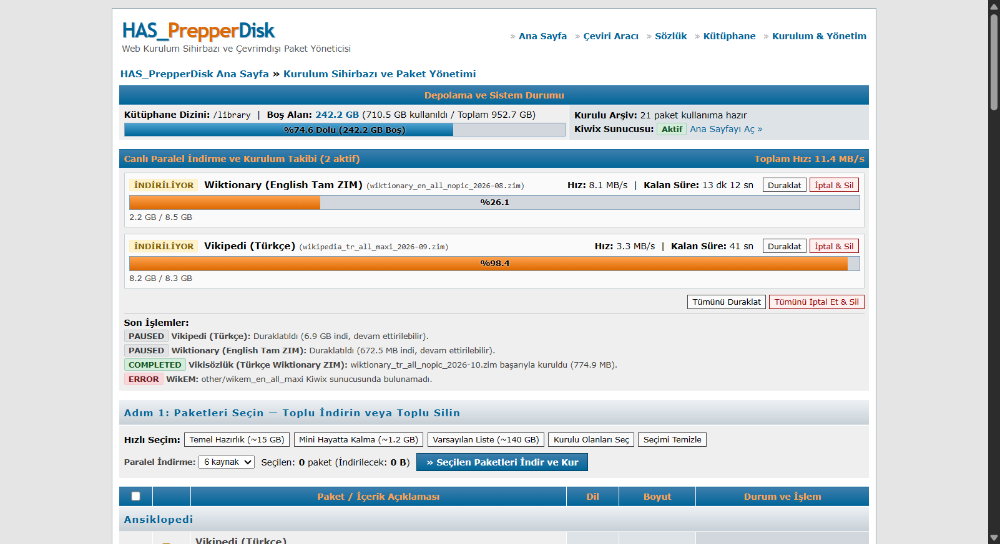

# Docker HAS_Prepper_Disk

<p align="center">
  <a href="https://github.com/schematrix/HAS_Prepper_Disk"></a>
  
  
  
  
  
  
</p>

<p align="center">
  <b>Docker ve Kiwix tabanlı, donanım bağımsız taşınabilir çevrimdışı bilgi, çeviri ve hayatta kalma kütüphanesi.</b><br>
  <i>A portable, hardware-independent offline knowledge, translation, and survival archive based on Docker and Kiwix.</i>
</p>

<p align="center">
  
</p>

<p align="center">
  <b><a href="#türkçe">Türkçe</a></b> &nbsp;·&nbsp; <b><a href="#english">English</a></b> &nbsp;·&nbsp; <b><a href="#hızlı-kurulum">Hızlı Kurulum</a></b> &nbsp;·&nbsp; <b><a href="#quick-start">Quick Start</a></b>
</p>

---

## Türkçe

### HAS Prepper Disk Nedir ve Ne İşe Yarar?

Deprem, sel, fırtına gibi büyük doğal afetlerde veya bölgesel altyapı çökmelerinde elektrik ve telekomünikasyon şebekeleri dakikalar içinde devre dışı kalabilir. Acil tıp müdahaleleri, temiz su arıtma yöntemleri, jeneratör ve araç tamiri, temel hijyen kuralları ve hayatta kalma kılavuzları tam da en çok ihtiyaç duyulduğu anda erişilemez hale gelir.

**Docker HAS_Prepper_Disk**, olası afet, kriz ve şebeke çökmesi senaryoları için geliştirilmiş taşınabilir ve **%100 çevrimdışı** çalışan bir dijital kütüphanedir. Seçilen arşiv paketleri bir kez indirildikten sonra harici internete sıfır bağımlılıkla çalışır. Yerel ağınıza (ev Wi-Fi ağı, Ethernet kablosu veya internetsiz çalışan taşınabilir bir seyahat yönlendiricisi) bağlanan herhangi bir akıllı telefon, tablet ya da bilgisayar; hiçbir uygulama yüklemeden, yalnızca standart bir web tarayıcısı üzerinden devasa bir bilgi havuzuna ulaşabilir.

Sistem içerisinde saha hekimlerinin kullandığı WikiMed tıp ansiklopedisi, elektronik ve mekanik araç tamir rehberleri (iFixit), resmi acil durum hazırlık dokümanları (Ready.gov), su arıtma ve gıda saklama teknikleri, StackExchange uzmanlık arşivleri (ev tamiratı, bahçecilik, mekanik, amatör telsiz) ile Türkçe ve İngilizce tam Vikipedi kopyaları yer alır.

### Orijinal Proje ile Farkı

Orijinal [schematrix/HAS_Prepper_Disk](https://github.com/schematrix/HAS_Prepper_Disk) projesi Raspberry Pi 5 donanımına özel bağımsız bir fiziksel cihaz, kendi Wi-Fi erişim noktası ve işletim sistemi kurulumu olarak tasarlanmışken; bu sürüm projeyi Docker destekleyen her bilgisayarda, ev sunucusunda, NAS cihazında veya Mini PC'de çalışabilen taşınabilir bir konteyner yapısına dönüştürür. Terminal üzerinden dosya düzenleme ihtiyacını ortadan kaldırarak paket indirme, depolama hesabı ve kütüphane yönetimini görsel bir Web Kurulum Sihirbazı (`/setup`) üzerinden sunar; ayrıca internetsiz İngilizce-Türkçe nöral çeviri (`/translate`) ve yerel çift yönlü sözlük (`/dictionary`) modüllerini ekleyerek tüm verileri diski formatlamadan standart depolama birimlerinde korur.

### Sistem Mimarisi ve Bileşenler

Uygulama, tek bir Docker konteyneri içinde hafif ve bağımsız modüller halinde çalışır:

* **FastAPI Web Sunucusu ve Ters Vekil (`app/main.py`):** Sistemin ana giriş kapısıdır (`:7572`). Harici CDN bağımlılığı olmayan retro phpBB2 forum temalı arayüzleri sunar, kütüphane okuma isteklerini (`/kiwix/*`) arka plandaki Kiwix servisine yönlendirir ve makale sayfalarına çevrimdışı gezinme/seç-çevir çubuğu enjekte eder.
* **Dinamik Kiwix Yöneticisi (`app/kiwix_manager.py`):** Arka planda `kiwix-serve` sürecini çalıştırır. Yeni bir ZIM arşivi indiğinde, yerel dosya olarak yüklendiğinde veya silindiğinde `kiwix-manage` ile `library.xml` indeksini dinamik olarak günceller ve kullanıcı oturumunu kesintiye uğratmadan kütüphaneyi anında yeniler.
* **Kesintiye Dayanıklı Paralel Asenkron İndirici (`app/downloader.py`):** Resmi Kiwix yansı sunucularını tarayarak paketlerin en güncel sürümlerini otomatik tespit eder. Aynı anda paralel (1–6 kanal) indirme, `.part` uzantısıyla HTTP Range devam ettirme, otomatik yeniden deneme (auto-retry), toplu silme ve harici `.zim` URL indirme desteği sunar.
* **Çevrimdışı Çok Dilli Nöral Çeviri Motoru (`app/translator.py`):** Argos Translate (CTranslate2 + SentencePiece) altyapısını kullanarak CPU üzerinde internet olmadan 15 dil arasında doğrudan veya İngilizce köprü (pivot) üzerinden çeviri yapar.
* **Çevrimdışı Çift Yönlü Kelime Sözlüğü (`app/dictionary.py`):** FreeDict tabanlı 11 dil çifti ve 550.000+ kelimeyi içeren SQLite veritabanlarında milisaniyeler içinde kelimesi kelimesine çift yönlü arama sunar.
* **Saha Araçları, Ortak Notlar ve Kişisel Belgeler (`/tools`, `/docs`):** Su klorlama, güneş/akü süresi, birim dönüştürücü ve ORS tuz-şeker oranı hesaplayıcılarını, yerel ağda ortak paylaşılan not defterini ve yer imlerini (`/tools`) ve çevrimdışı çeviri destekli kişisel belge kitaplığını (`/docs`) içerir.
* **Kalıcı Depolama Alanı (`./library`):** ZIM arşivleri (`/zims/content`), çeviri modelleri (`/models`), sözlük veritabanları (`/dictionaries`), ortak notlar (`/notes`) ve kişisel belgeler (`/docs`) diski formatlamaya gerek kalmadan ana sistemdeki bu klasörde saklanır.

### Hızlı Kurulum

**1. Repoyu indirin**
```bash
git clone https://github.com/woloop/Docker-HAS_Prepper_Disk.git
cd Docker-HAS_Prepper_Disk
```

**2. Konteyneri başlatın**
```bash
docker compose up -d --build
# veya doğrudan: ./install.sh
```

**3. Web arayüzlerini kullanın**
* **Kurulum ve Paket Yöneticisi:** `http://localhost:7572/setup` — İndirilecek ZIM arşivlerini, sözlükleri ve çeviri dillerini seçip paralel indirmeleri takip edin veya kendi `.zim` dosyanızı yükleyin.
* **Kütüphane Portalı:** `http://localhost:7572/home` — İndirilen Vikipedi, tıp ve tamir rehberlerini çevrimdışı okuyun.
* **Çevrimdışı Sözlük:** `http://localhost:7572/dictionary` — İnternet olmadan 11 dilde çift yönlü kelimesi kelimesine sözlük araması yapın.
* **Çevrimdışı Çeviri:** `http://localhost:7572/translate` — Yabancı dildeki metin ve dokümanları yerel yapay zeka ile çevirin.
* **Araçlar ve Notlar:** `http://localhost:7572/tools` — Su arıtma, enerji, birim ve ORS hesaplayıcılarını, ortak not defterini ve kütüphane yer imlerini kullanın.
* **Kişisel Belgeler:** `http://localhost:7572/docs` — Kendi PDF, TXT ve Markdown belgelerinizi yükleyin, okuyun ve çevrimdışı çevirin.

### Harici Disk ve Depolama Yapılandırması

İndirilen arşiv dosyalarını harici bir SSD'de, flash bellekte veya ağa bağlı bir NAS paylaşımında tutmak için diski formatlamadan yolunu belirtmeniz yeterlidir:

```bash
PREPPER_LIBRARY_PATH=/mnt/harici_disk/library docker compose up -d
```

Dilerseniz bu ayarı ana dizinde bir `.env` dosyası oluşturarak da tanımlayabilirsiniz:
```env
PREPPER_LIBRARY_PATH=/mnt/harici_disk/library
PORT=7572
```

### Lisans

Bu proje [MIT Lisansı](LICENSE) ile lisanslanmıştır.
Orijinal çalışma Copyright (c) 2026 Burak Bozkurt. Değişiklikler Copyright (c) 2026 woloop.

İndirilen tüm içerik arşivleri (Vikipedi, StackExchange, iFixit vb.) ve Kiwix kendi bağımsız açık lisanslarına tabidir.

---

## English

### What is HAS Prepper Disk?

In major natural disasters, regional power blackouts, or extended telecommunications outages, electricity and communication networks can collapse within minutes. Critical emergency procedures, clean water sanitation techniques, generator and vehicle repairs, essential hygiene rules, and survival guides become inaccessible right when they are needed most.

**Docker HAS_Prepper_Disk** is a portable, self-contained digital knowledge and survival library designed for disaster, crisis, and grid-down scenarios. Once selected archive packages are downloaded, the entire system operates **100% offline** with zero internet dependency. Any smartphone, tablet, laptop, or desktop connected to your local network (home Wi-Fi, Ethernet, or an offline travel router) can access this vast repository of knowledge through any standard web browser without installing any client applications.

The system includes WikiMed (the medical encyclopedia trusted by field physicians), electronic and vehicle repair guides (iFixit), official disaster preparation manuals (Ready.gov), water purification and food preservation techniques, specialized StackExchange archives (DIY, gardening, mechanics, ham radio), as well as complete Turkish and English Wikipedia archives.

### Differences from the Original Project

While the original [schematrix/HAS_Prepper_Disk](https://github.com/schematrix/HAS_Prepper_Disk) was built specifically as a dedicated physical Raspberry Pi 5 unit with its own Wi-Fi hotspot and operating system installation, this edition adapts the project into a portable Docker container that runs on any computer, home server, NAS appliance, or Mini PC. Instead of terminal-based configuration, it introduces a browser-based Web Setup Wizard (`/setup`) for package management, storage calculation, and live download tracking, along with integrated offline neural translation (`/translate`) and local bidirectional dictionaries (`/dictionary`), storing all data non-destructively through standard storage mounts without formatting any drives.

### System Architecture and Components

The application operates as lightweight, decoupled modules within a single Docker container:

* **FastAPI Web Server & Reverse Proxy (pp/main.py):** The primary entrypoint on port 7572. It serves retro phpBB2-themed interfaces with zero external CDN dependencies, transparently reverse-proxies library reading requests (/kiwix/*) to the background Kiwix service, and injects an offline navigation and select-to-translate helper bar into article pages.
* **Dynamic Kiwix Manager (pp/kiwix_manager.py):** Supervises the embedded kiwix-serve daemon. Whenever new ZIM archives are downloaded, uploaded locally, or deleted, it dynamically updates the library.xml index via kiwix-manage, hot-reloading the library without interrupting user reading sessions.
* **Resumable Parallel Async Downloader (pp/downloader.py):** Scrapes official Kiwix mirrors to automatically resolve the latest release dates for packages. It supports concurrent parallel downloads (1–6 streams), HTTP Range resumption via .part files, automatic retry on network drops, bulk deletion, and custom external .zim URL downloads.
* **Offline Multi-Language Neural Translation Engine (pp/translator.py):** Leverages Argos Translate (CTranslate2 + SentencePiece) to run CPU-optimized neural translation models completely offline across 15 languages, directly or through an automatic English pivot bridge.
* **Offline Bidirectional Word Dictionary (pp/dictionary.py):** Provides instant, sub-millisecond word-for-word searches across SQLite databases covering 11 FreeDict language pairs and over 550,000 terms.
* **Field Tools, Shared Notes, and Personal Documents (/tools, /docs):** Includes offline water disinfection, solar/battery runtime, unit conversion, and ORS electrolyte calculators, alongside a shared local LAN bulletin board with bookmarks (/tools), and a personal document library with offline translation support (/docs).
* **Offline Vector Maps & Captive Portal (/maps, OfflineMapManager):** Serves an interactive vector map of Turkey based on OpenStreetMap and Protomaps PMTiles (/maps), and provides captive portal probe endpoints to automatically redirect connecting Wi-Fi devices (Android, iOS, Windows) directly to /home.
* **Persistent Storage Mount (./library):** ZIM archives (/zims/content), map data (/maps), neural models (/models), dictionary databases (/dictionaries), shared notes (/notes), and personal documents (/docs) are safely stored in this directory on the host system without requiring drive formatting.

### Quick Start

**1. Clone the repository**
\\ash
git clone https://github.com/woloop/Docker-HAS_Prepper_Disk.git
cd Docker-HAS_Prepper_Disk
\
**2. Start the container**
\\ash
docker compose up -d --build
# or execute: ./install.sh
\
**3. Access the web interfaces**
* **Setup & Package Manager:** http://localhost:7572/setup — Select ZIM archives, dictionaries, and translation languages, monitor parallel downloads, or upload your own .zim files.
* **Knowledge Portal:** http://localhost:7572/home — Browse installed Wikipedia, WikiMed, and practical repair guides.
* **Offline Dictionary:** http://localhost:7572/dictionary — Search word-for-word across 11 languages without internet.
* **Offline Translation:** http://localhost:7572/translate — Translate foreign documents locally using neural AI.
* **Tools and Notes:** http://localhost:7572/tools — Use water treatment, energy, unit, and ORS calculators, shared LAN field notes, and bookmarks.
* **Personal Documents:** http://localhost:7572/docs — Upload, read, and offline-translate your own PDF, TXT, and Markdown documents.
* **Offline Vector Maps:** http://localhost:7572/maps — Explore the offline vector map of Turkey.

### Custom Storage Configuration

To store downloaded archive files on an external SSD, USB drive, or network NAS mount without formatting, simply specify the directory path:

```bash
PREPPER_LIBRARY_PATH=/mnt/custom_disk/library docker compose up -d
```

You can also define this setting in a `.env` file in the project root:
```env
PREPPER_LIBRARY_PATH=/mnt/custom_disk/library
PORT=7572
```

### License

This project is released under the [MIT License](LICENSE).
Original work Copyright (c) 2026 Burak Bozkurt. Modifications Copyright (c) 2026 woloop.

All downloaded content archives (Wikipedia, StackExchange, iFixit, etc.) and Kiwix remain subject to their respective original open licenses.
