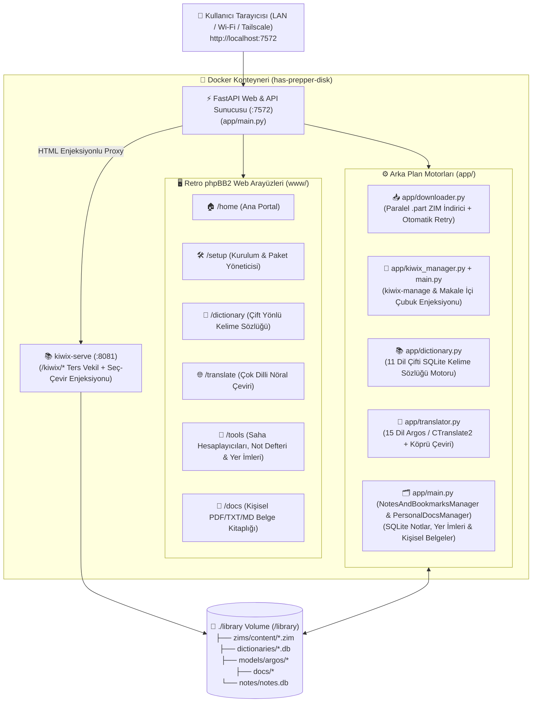

# 🏗️ HAS Prepper Disk (Fork & Docker/Web Edition v2.5) - Teknik Mimari ve Sistem Dokümantasyonu

## 1. Fork Yaklaşımı ve Tasarım İlkeleri

Bu proje, [schematrix/HAS_Prepper_Disk](https://github.com/schematrix/HAS_Prepper_Disk) projesini **fork'layarak (çatallayarak)** mevcut mimarinin üzerine tam kapsamlı bir çevrimdışı web ve saha ekosistemi inşa eder:

1. **Dosya, Dizin ve Görsel Standartların Korunması:**
   * Tüm kalıcı veriler `/library` dizini altında (`./library:/library` Docker volume bağlaması) saklanır.
   * Tüm web sayfaları (`/home`, `/setup`, `/dictionary`, `/translate`, `/tools`, `/docs`) orijinal **retro phpBB2 forum tablosu** görsel stilini korur ve **%100 çevrimdışı** (sıfır harici CDN, sıfır harici font/script) çalışır.
2. **Donanım ve IIAB Bağımlılıklarının Kaldırılması:**
   * Fiziksel disk formatlama (`scripts/setup-ssd.sh`) ve Internet-in-a-Box (`iiab`) bağımlılıkları yerine izole Docker konteyneri (`FastAPI + kiwix-tools + CTranslate2 + SQLite`) kullanılmıştır.
3. **Yüksek Performanslı Bind-Mount Önbellekleme:**
   * Windows/WSL2 (9p) veya harici USB disklerde yoğun G/Ç gecikmesini önlemek için SQLite veritabanları (`/library/dictionaries/*.db`, `/library/notes/notes.db`) konteyner içi hızlı `/tmp` önbelleğine yansıtılır ve yazma işlemlerinde otomatik senkronize edilir. ZIM indirmeleri 2 MB bellek tamponlarıyla asenkron olarak diske yazılır.

---

## 2. Sistem Mimarisi Diyagramı



---

## 3. Proje Dizin Yapısı

```text
HAS_Prepper_Disk/
├── app/                        # FastAPI Arka Plan Servisleri
│   ├── main.py                 # Ana FastAPI sunucusu, yönlendirmeler, REST API, Notlar/Belgeler ve /kiwix/* proxy
│   ├── config_parser.py        # config/content.conf ayrıştırıcı ve bellek içi ZIM tarama önbelleği
│   ├── downloader.py           # Paralel (1-6 kanal), .part destekli, otomatik yeniden denemeli ZIM indirici
│   ├── kiwix_manager.py        # library.xml oluşturucu ve kiwix-serve süreç yöneticisi
│   ├── dictionary.py           # 11 dil çifti FreeDict TEI->SQLite derleyici ve çift yönlü kelime arama motoru
│   ├── translator.py           # 15 dil Argos/CTranslate2 sinirsel çeviri ve otomatik Pivot (Köprü) motoru
│   └── requirements.txt        # Python bağımlılıkları
├── www/                        # %100 Çevrimdışı Retro phpBB2 Web Arayüzleri
│   ├── home/index.html         # Ana kütüphane ve araçlar portalı (/home)
│   ├── setup/index.html        # Kurulum sihirbazı, paralel indirme, toplu silme ve model yönetimi (/setup)
│   ├── dictionary/index.html   # Kelimesi kelimesine çift yönlü sözlük arayüzü (/dictionary)
│   ├── translate/index.html    # Çok dilli çevrimdışı nöral çeviri arayüzü (/translate)
│   ├── tools/index.html        # Saha hesaplayıcıları + ortak not defteri ve yer imleri (/tools ve /notes)
│   └── docs/index.html         # Kişisel PDF/TXT/MD belge yükleme, okuma ve çeviri arayüzü (/docs)
├── config/
│   └── content.conf            # İndirilebilir ZIM paketleri katalog yapılandırması
├── docs/
│   └── ARCHITECTURE.md         # Teknik mimari ve API dokümantasyonu
├── Dockerfile                  # Konteyner imaj tanımı
└── docker-compose.yml          # Tek komutla çalıştırma yapılandırması
```

---

## 4. Web Sayfaları ve REST API Uç Noktaları Referansı

### 4.1. Kullanıcı Arayüzü Rotaları

| Rota | Dosya | Açıklama |
| :--- | :--- | :--- |
| `GET /` | `app/main.py` | Kurulu ZIM varsa `/home`, yoksa `/setup` sayfasına yönlendirir. |
| `GET /home` | `www/home/index.html` | Çevrimdışı araçları ve kurulu ZIM arşivlerini kategoriler halinde sunar. |
| `GET /setup` | `www/setup/index.html` | ZIM katalog indirme, paralel hız takibi, toplu silme, özel ZIM URL/dosya yükleme, sözlük ve çeviri modeli yönetimi. |
| `GET /dictionary` | `www/dictionary/index.html` | 3 sütunlu (`Kelime`, `Yön`, `Anlamı`) çift yönlü kelime sözlüğü ve `A–Z` harf gezgini. |
| `GET /translate` | `www/translate/index.html` | 15 dil destekli çevrimdışı yapay zeka metin çevirici. |
| `GET /tools` (ve `/notes`) | `www/tools/index.html` | Sadeleştirilmiş su klorlama, akü/güneş süresi, birim dönüştürücü ve ORS tuz-şeker oranı hesaplayıcıları + ortak not defteri ve kütüphane yer imleri. |
| `GET /docs` | `www/docs/index.html` | Kişisel belge yükleme (`.pdf`, `.txt`, `.md`, `.html`, `.csv`, `.epub`), okuma ve çevrimdışı çeviri. |
| `GET /kiwix/*` | `kiwix-serve` + Proxy | Kiwix arşiv sayfalarını sunar ve HTML yanıtlarına `/api/kiwix-helper.js` üst çubuk / seç-çevir aracını enjekte eder. |

### 4.2. REST API Uç Noktaları

| Yöntem & Uç Nokta | Açıklama |
| :--- | :--- |
| `GET /api/status` | Disk kullanımı, kurulu ZIM sayısı, Kiwix durumu, aktif indirmeler, sözlük ve çeviri özetini döndürür. |
| `GET /api/catalog` | Tüm ZIM kataloğunu, kurulu/kısmi boyutları, sözlük ve çeviri paket durumlarını döndürür. |
| `POST /api/downloads/start` | Seçilen ZIM paketlerini paralel indirme kuyruğuna ekler. |
| `POST /api/downloads/custom-url` | Katalog dışındaki özel bir `.zim` URL'sini indirme kuyruğuna ekler. |
| `POST /api/packages/upload-zim` | Kullanıcının cihazından yüklediği yerel `.zim` dosyasını `/library/zims/content` dizinine kaydeder ve Kiwix'i yeniler. |
| `POST /api/downloads/concurrency` | Eşzamanlı indirme sayısını (`1–8`) çalışma anında günceller. |
| `GET /api/downloads/progress` | Aktif indirmelerin anlık yüzdesini, hızını (`MB/s`) ve kalan süresini (`ETA`) döndürür. |
| `POST /api/downloads/cancel` | Belirli bir indirmeyi veya tüm kuyruğu duraklatır / iptal eder. |
| `DELETE /api/packages/{prefix}` | Tek bir ZIM paketini diskten siler ve Kiwix indeksini günceller. |
| `POST /api/packages/bulk-delete` | Seçilen birden fazla ZIM paketini toplu olarak siler. |
| `GET /api/dictionary/status` | 11 FreeDict sözlük paketinin kurulum ve kelime sayısı durumunu döndürür. |
| `POST /api/dictionary/packs/download` | Seçilen FreeDict sözlük paketlerini indirip çift yönlü SQLite veritabanına derler. |
| `DELETE /api/dictionary/packs/{pack_id}` | Belirtilen sözlük paketini diskten siler. |
| `GET /api/dictionary/search` | Kurulu sözlüklerde milisaniyeler içinde tam/önek kelime araması yapar (`q`, `pack_id`, `direction`, `limit`). |
| `GET /api/translate/status` | 15 dil için Argos/CTranslate2 sinirsel çeviri modellerinin durumunu döndürür. |
| `POST /api/translate/models/download` | Seçilen dil çifti modellerini (`en↔lang`) indirir ve kurar. |
| `DELETE /api/translate/models/{lang}` | Belirtilen dilin çeviri modellerini diskten kaldırır. |
| `POST /api/translate` | Metni kaynak dilden hedef dile doğrudan veya İngilizce köprü (pivot) üzerinden çevrimdışı çevirir. |
| `GET /api/notes` | Ortak saha notlarını ve kayıtlı kütüphane yer imlerini listeler (`q`, `category`). |
| `POST /api/notes/bookmarks` | Yeni bir kütüphane yer imi kaydeder. |
| `DELETE /api/notes/bookmarks/{id}` | Yer imini siler. |
| `POST /api/notes/items` | Yeni bir saha notu / kontrol listesi yayınlar. |
| `POST /api/notes/items/{id}/pin` | Saha notunu üste sabitler veya sabitini kaldırır. |
| `DELETE /api/notes/items/{id}` | Saha notunu siler. |
| `GET /api/docs` | `/library/docs` altındaki kişisel belgeleri listeler. |
| `POST /api/docs/upload` | Base64 veya düz metin olarak kişisel belge yükler/oluşturur. |
| `GET /api/docs/read/{filename}` | Metin tabanlı belgelerin içeriğini okuyucu paneli için döndürür. |
| `GET /api/docs/raw/{filename}` | Belgeyi (PDF, EPUB, TXT, MD) doğrudan görüntüler veya indirir. |
| `DELETE /api/docs/{filename}` | Kişisel belgeyi diskten siler. |
| `GET /api/kiwix-helper.js` | Kiwix makalelerinin içine enjekte edilen üst gezinme çubuğu ve seç-çevir/sözlük betiğini sunar. |
